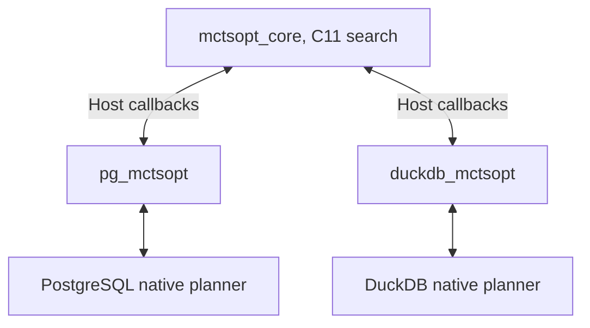

# mctsopt

**mctsopt is a shared MCTS join-order search engine for PostgreSQL and DuckDB.**
It separates search policy from database-specific planning. A portable C11 core
explores join alternatives through adapter callbacks, while each database retains
its native legality checks, cardinality estimates, cost model, and plan construction.

## Architecture



Both adapters compile the same core. Each extension runs inside its own database
process; there is no separate search service.

| Component | Responsibility |
| --- | --- |
| `mctsopt_core` | UCT selection, expansion, rollouts, rewards, iteration budgets, and restarts |
| Adapter | Native relation handles, host callbacks, settings, memory lifetime, cancellation, and diagnostics |
| Database | Join legality, cardinality estimation, costing, native plan construction, and execution |

The core searches through opaque relation handles. It does not produce a portable
physical plan. Adapters ask their database to build and cost join alternatives,
so the search space and cost model remain database-specific. DuckDB's native memo
can recombine explored subplans when reconstructing the final plan.

The callback interface is documented in [the host contract](docs/host-contract.md).
[`ablation`](../ablation/README.md) runs parameter sweeps and compares results.
[`mcts_extreme`](../mcts_extreme/) is an independent PostgreSQL implementation for
comparison; it does not use this core.

## Build and test

From this directory:

```sh
cmake -S . -B build -DCMAKE_BUILD_TYPE=Debug
cmake --build build
```

Tests use PostgreSQL `pg_regress` and DuckDB SQLLogicTest:
[PostgreSQL](pg_mctsopt/README.md), [DuckDB](duckdb_mctsopt/README.md).
Experiment tooling and its Python tests live in [`ablation`](../ablation/README.md).

SQL tests check answers, settings, traces, budgets, initialization, fallback, and
error recovery. They do not inject callback failures or assert internal reward
arithmetic.
